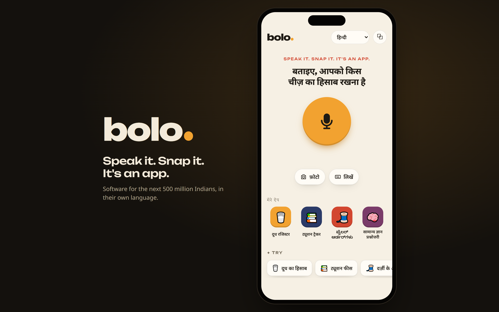
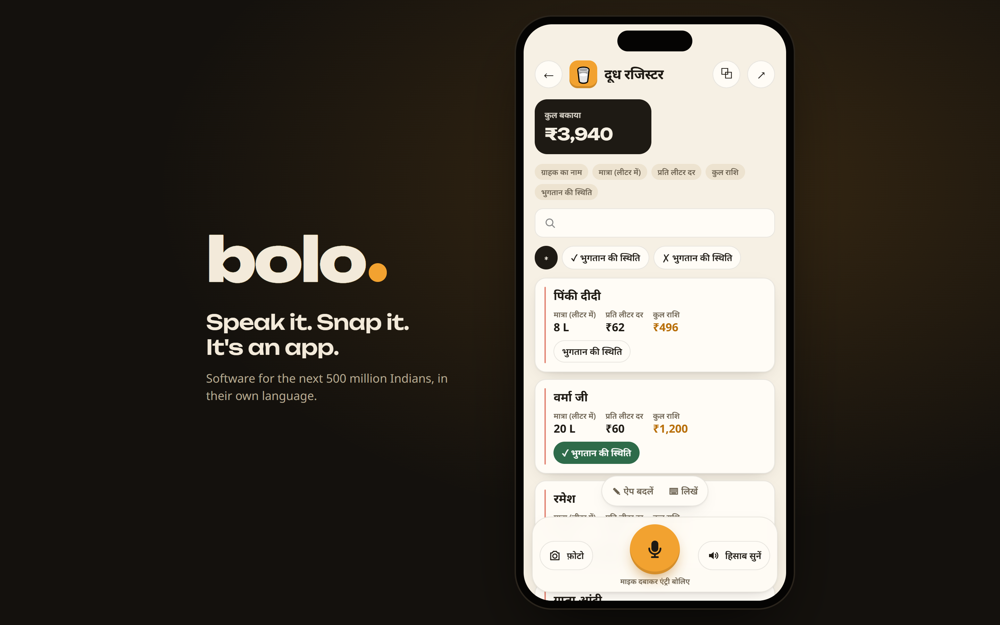
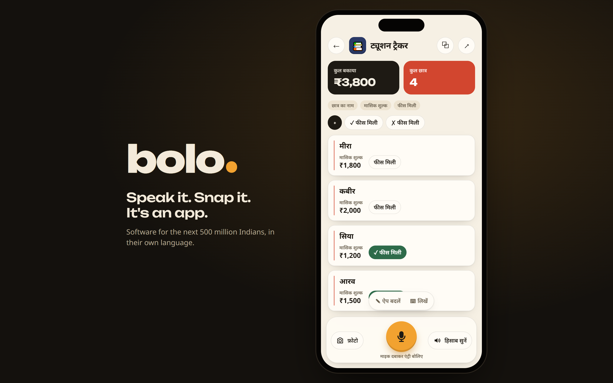
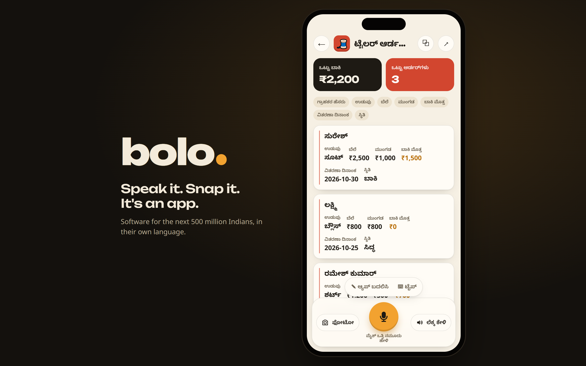
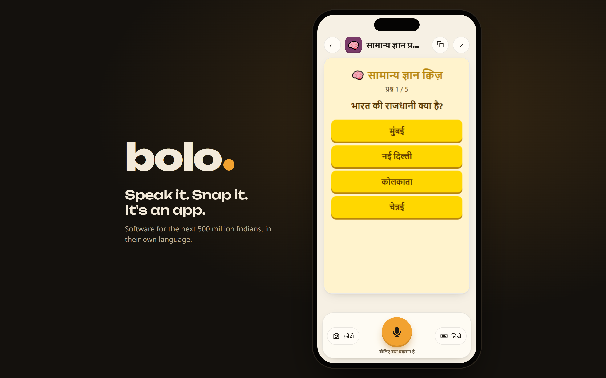
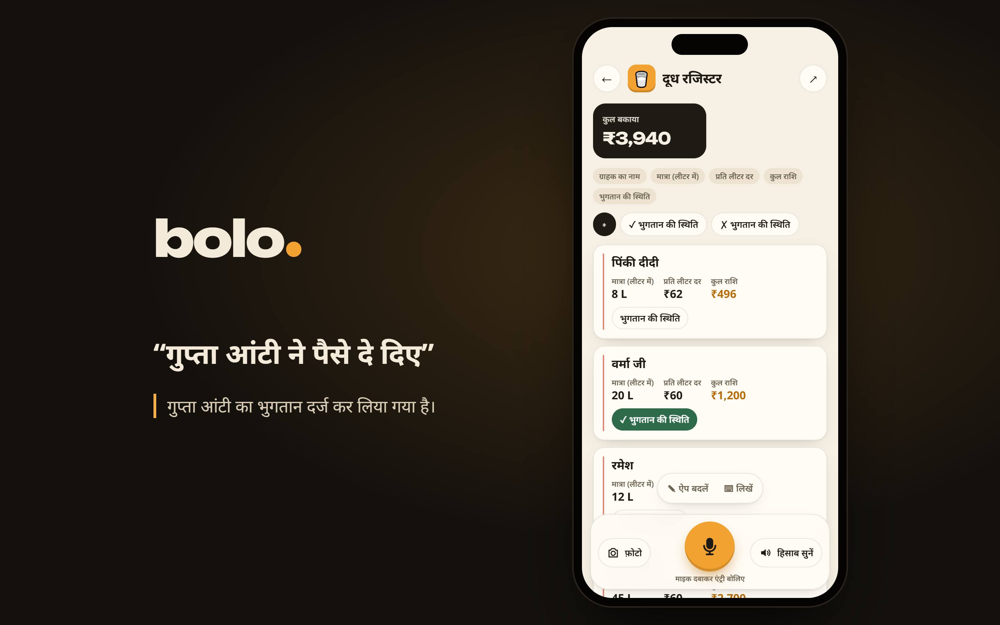

# Bolo

**Speak it. Snap it. It's an app.**

No-code tools were built for people who can't code. Bolo is built for people who can't type.

A milkman, a tuition teacher, a tailor or a kirana owner describes the app they need, out loud, in their own language, or photographs the notebook they already keep. Seconds later they have a working app in their own script: records, totals, dues, search and filters, all of it filled in and kept up to date by voice.

<table>
  <tr>
    <td></td>
    <td></td>
  </tr>
  <tr>
    <td align="center"><b>दूध रजिस्टर</b>: built from a photo of a handwritten register</td>
    <td align="center"><b>ट्यूशन ट्रैकर</b>: built and filled entirely by voice</td>
  </tr>
  <tr>
    <td></td>
    <td></td>
  </tr>
  <tr>
    <td align="center"><b>ಟೈಲರ್ ಆರ್ಡರ್‌ಗಳು</b>: the same idea in Kannada</td>
    <td align="center"><b>सामान्य ज्ञान क्विज़</b>: not record-keeping, so Bolo wrote it as code</td>
  </tr>
</table>

<i>Stage mode: after pairing with a code, any big screen mirrors the phone, with live captions and Bolo's voice for the room.</i>

## What it does

- **Speak an app into existence.** "मुझे 20 घरों का दूध का हिसाब रखना है" becomes a milk-delivery app with litres, rate, amount and paid/unpaid, plus a "total due" card.
- **Snap a notebook, get an app with your data.** A photo of a handwritten register becomes a filled-in app: every customer, every amount, every ✓.
- **Use it by voice every day.** "शर्मा जी ने आज एक लीटर और लिया" adds to Sharma ji's row; "पैसे दे दिए" marks them paid. Spoken numbers like "ढाई" (2.5) or "sattar" (70) are understood.
- **Change it by voice.** "Add the father's phone number too" adds a field and keeps every saved entry. Every version is kept, with undo.
- **It talks back.** Confirmations and a spoken summary of the totals, in the user's language.
- **Anything else is written as code.** If a request isn't record-keeping (a quiz, a timer), Bolo writes a small app from scratch and runs it in a sandbox, repairing it automatically if it breaks on start-up.
- **Your apps live on your home screen.** Every app you speak gets its own icon in Bolo's launcher, and Bolo can be installed like a normal app.
- **Present on any big screen.** Tap ⧉ on the phone, type the 4-character code on the screen's `/stage` page, and the screen mirrors the phone, with live captions and Bolo's voice for the room.

## Languages

People can speak, and photograph documents, in 22 Indian languages plus English. Apps are labelled in the user's own script. Spoken replies are available in Hindi, Bengali, Tamil, Telugu, Gujarati, Kannada, Malayalam, Marathi, Punjabi, Odia and English.

## Built on Sarvam

| Step | Model |
|---|---|
| Voice → text, any Indian language or mix | **Saaras v4** |
| Designing the app, understanding entries, summaries, writing code | **Sarvam-105B** |
| Reading handwritten and printed notebooks | **Sarvam Vision** |
| Understanding photos of shelves, menus, scenes | **Gemma 4** on Sarvam's platform |
| App labels and replies in the user's language | **Sarvam-Translate** |
| Speaking back | **Bulbul v4 Flash** (Bulbul v3 for Malayalam and Odia) |

Totals, dues and formulas are always calculated by Bolo's own code. The model only interprets what was said, so a number on screen is never a model's guess.

## Running it

1. `pip install -r requirements.txt`
2. Put your Sarvam key in `.env` as `SARVAM_API_KEY=...` (never commit it).
3. Create a Supabase project, run `supabase.sql` in its SQL editor, and put the project URL and publishable key in `config.js`.
4. Deploy to Vercel, adding `SARVAM_API_KEY` as an environment variable.

## How it's built

- `index.html` + `app.js`: the app (phone-first; on wider screens it runs inside a phone frame).
- `stage.html` + `stage.js`: presentation mode for a big screen.
- `api/bolo.py`: the backend, one Vercel Python function that talks to Sarvam. The API key never reaches the browser.
- `store.js` + `supabase.sql`: apps are saved in Supabase and can only be opened by their secret link.

[`flow.md`](flow.md) walks through how execution moves between files. [`decisions.md`](decisions.md) records every design decision and why it was made.
